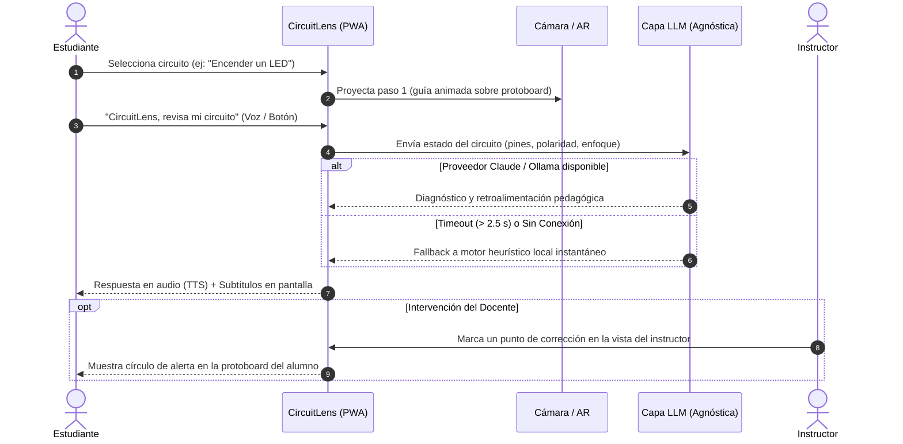

# 🔬 CircuitLens · Laboratorio de Electrónica Móvil

[](LICENSE)
[](src/circuitlens.html)
[-7aa2ff.svg)](docs/ARQUITECTURA.md)
[](docs/ARQUITECTURA.md)

**CircuitLens** es una Progressive Web App (PWA) de asistencia inteligente para laboratorios de electrónica práctica. Combina **Realidad Aumentada (AR)** superpuesta a la cámara del dispositivo móvil, interacción multimodal por **voz y subtítulos en vivo**, y un motor de **diagnóstico pedagógico agnóstico con Inteligencia Artificial**.

---

## 🚀 Características Principales

- **👓 Realidad Aumentada sobre Protoboard**: Guías visuales vectoriales superpuestas al circuito físico para indicar paso a paso la posición exacta de cables, resistencias y LEDs.
- **🎙 Asistencia por Voz y Manos Libres**: Reconocimiento de voz continuo con palabra clave («*CircuitLens, revisa mi circuito*») y síntesis de voz pedagógica en español.
- **🧠 Capa LLM Agnóstica y Resiliente**:
  - **Local Simulado**: Motor heurístico ultra-rápido (< 350 ms) y 100% offline.
  - **Anthropic Claude**: Análisis de contexto profundo mediante `claude-sonnet-4-6`.
  - **Ollama Local**: Inferencia multimodal soberana y privada mediante `llama3.2-vision`.
  - **Fallback automático**: Si el proveedor remoto falla o supera 2.5 s, se activa el modo simulado sin interrumpir la clase.
- **👨‍🏫 Panel del Instructor en Tiempo Real**: Dibujo interactivo bidireccional sobre el protoboard del estudiante usando canales de sincronización `BroadcastChannel`.
- **📊 Panel Institucional Anonimizado**: Métricas agregadas de rendimiento de cohorte (tasas de completitud de circuitos, errores frecuentes como polaridad invertida y latencias).
- **♿ Accesibilidad Universal**:
  - **Modo Daltonismo**: Etiquetas legibles con valor en ohmios y códigos de colores en resistencias.
  - **Alto Contraste**: Paleta optimizada para estudiantes con baja visión.
  - **Baja Estimulación**: Desactivación completa de animaciones para usuarios con hipersensibilidad o TDAH.

---

## ⚡ Inicio Rápido

Al ser una aplicación web pura (HTML5, Vanilla CSS y JavaScript estándar), no requiere compilación ni dependencias pesadas.

### 1. Clonar el repositorio
```bash
git clone https://github.com/tu-usuario/Proyecto-CircuitoLens.git
cd Proyecto-CircuitoLens
```

### 2. Levantar el servidor local
Para habilitar permisos de hardware (cámara y micrófono):

**Con Python:**
```bash
python -m http.server 8000
```
Abre en tu navegador: **[http://localhost:8000/src/circuitlens.html](http://localhost:8000/src/circuitlens.html)** (o directamente `http://localhost:8000`).

**Con Node.js:**
```bash
npx serve .
```

---

## 🔄 Flujo de Interacción



---

## 📁 Estructura del Proyecto

```text
Proyecto-CircuitoLens/
│
├── README.md                 # Documentación general y descripción
├── LICENSE                   # Licencia de código abierto MIT
├── index.html                # Punto de entrada / redirección a la PWA
├── style.css                 # Estilos CSS globales desminificados
├── script.js                 # Lógica principal de circuitos, AR y LLM
│
├── src/                      # Código fuente de la aplicación PWA
│   ├── circuitlens.html      # Prototipo PWA principal (AR, voz, LLM, panel)
│   ├── style.css             # Estilos modulares de la aplicación
│   ├── script.js             # Módulos JavaScript de la PWA
│   └── manifest.json         # Manifiesto de aplicación PWA móvil
│
├── docs/                     # Documentación de ingeniería y despliegue
│   ├── ARQUITECTURA.md       # Diagramas C4 (Contexto, Contenedores, Componentes)
│   └── INSTALACION.md        # Guía de configuración de Claude u Ollama
│
└── data/                     # Datos estructurados y datasets de simulación
    ├── cohorte.json          # Datos de simulación de 24 alumnos (métricas anonimizadas)
    ├── circuitos.json        # Definición esquemática de los 5 circuitos y componentes
    └── diagnosticos.json     # Guiones pedagógicos, reglas heurísticas y prompts
```

---

## 👨‍💻 Autor

- **Edwin** — Desarrollo, arquitectura y diseño de CircuitLens.

---

## 📄 Licencia

Este proyecto se encuentra bajo la Licencia **MIT**. Consulta el archivo [LICENSE](LICENSE) para más detalles.
