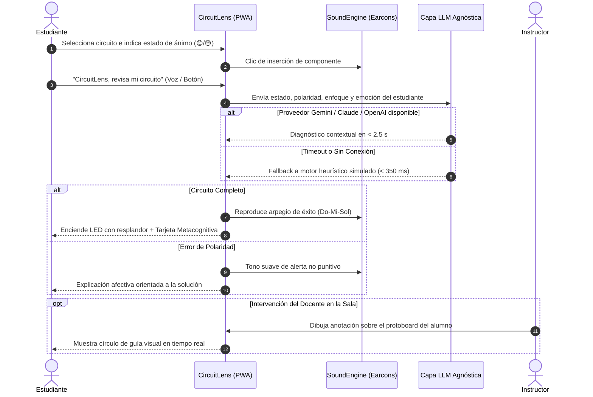

# 🔬 CircuitLens · Laboratorio de Electrónica Móvil

[](LICENSE)
[-0b6e4f.svg)](src/circuitlens.html)
[-7aa2ff.svg)](docs/ARQUITECTURA.md)
[](docs/ARQUITECTURA.md)
[](docs/REPORTE_AVANCE_PC03.md)

**CircuitLens** es una Progressive Web App (PWA) de asistencia inteligente para laboratorios de electrónica práctica con **interfases no convencionales**. Combina **Realidad Aumentada (AR)** superpuesta a la cámara del dispositivo móvil, interacción multimodal continua por **voz y subtítulos en vivo**, un motor de **diagnóstico pedagógico agnóstico con Inteligencia Artificial** (.env configurable), **personalización continua del perfil del estudiante**, **salas multiusuario en tiempo real** y **diseño emocional** basado en los tres niveles de Don Norman.

---

## 🚀 Capacidades Obligatorias Implementadas (PC03)

### 1. 🎙 Interfases de Voz y Multimodalidad
- **Reconocimiento continuo y manos libres:** Activación por palabra clave («*CircuitLens, revisa mi circuito*») o mediante botón push-to-talk.
- **Síntesis de voz (TTS):** Locución en español con ajuste dinámico de velocidad y tono adaptativo.
- **Visualizador dinámico de onda de audio:** Indicador sensorial animado cuando el asistente habla o escucha.
- **Subtitulado permanente accesible:** Subtítulos en tiempo real con soporte para lectores de pantalla (`aria-live="polite"`).

### 2. 🧠 Capa LLM Agnóstica y Resiliente con `.env`
- **Simulado Local:** Motor heurístico ultra-rápido (< 350 ms) y 100% offline.
- **Google Gemini API:** Razonamiento pedagógico rápido con `gemini-1.5-flash` o `gemini-2.0-flash`.
- **Anthropic Claude:** Análisis multimodal y contextual con `claude-sonnet-4-6`.
- **OpenAI:** Consultas estructuradas con `gpt-4o-mini`.
- **Ollama Local:** Inferencia soberana y privada mediante `llama3.2-vision` en puerto 11434.
- **Configuración desacoplada:** Soporte para archivo `.env` en la raíz (y `.env.example`).
- **Fallback automático (< 2.5 s):** Si el proveedor remoto falla o supera el tiempo límite, se activa el motor simulado local sin interrumpir la sesión del estudiante.

### 3. 📱 Plataforma PWA (100% Offline Ready)
- **Service Worker:** Estrategia *Cache-First/Stale-While-Revalidate* para assets, estilos, scripts y datasets JSON.
- **Instalación directa:** Botón interactivo *«📲 Instalar App»* para instalar como app de escritorio o móvil independiente.
- **Detección de conectividad:** Conmutación automática a modo offline garantizado.

### 4. 👤 Personalización Continua (Perfil Persistente)
- **Preferencias:** Nivel pedagógico (básica, detallada), tono del tutor y velocidad de habla.
- **Ritmo de aprendizaje:** Medición de segundos por componente y clasificación en vivo (*Pausado*, *Constante*, *Ágil*).
- **Registro de errores:** Historial acumulativo de errores típicos (polaridad invertida, resistencia omitida).
- **Emociones declaradas e inferidas:** Selector de estado de ánimo (😊, 🤔, 😓, ⚡, 😴) y detección automática de frustración por bloqueos o errores recurrentes, modulando las respuestas del tutor hacia el aliento constructivo.

### 5. 👥 Salas Multiusuario y Colaboración Docente
- **Salas nombradas:** Gestión de salas compartidas (ej. `SALA-ELECTRO-1`) y enlaces directos (`?sala=...`).
- **Monitoreo en vivo:** El instructor visualiza el listado de alumnos conectados con su circuito, paso actual y estado emocional.
- **Pizarra bidireccional:** El profesor puede dibujar correcciones visuales o puntero láser sobre el protoboard del alumno usando canales `BroadcastChannel` y `localStorage`.
- **Pistas afectivas:** Botones para enviar pistas directas al estudiante con alerta sonora.

### 6. ❤️ Diseño Emocional de Don Norman
- **Nivel Visceral:** Protoboard realista en SVG, encendido de LED con resplandor luminoso dinámico (`led-glow`), ondas de sonido y confeti multicromático.
- **Nivel Conductual:** Clic directo sobre los pines resaltados del protoboard para insertar componentes, retroalimentación háptica (vibración) y **Earcons acústicos sintetizados con Web Audio API** (arpegio de éxito Do-Mi-Sol y tono suave de precaución).
- **Nivel Reflexivo:** Tarjetas de metacognición al completar cada circuito («¿Qué aprendiste hoy?») y tono adaptativo empático para fortalecer la autoestima del estudiante.

---

## ⚡ Inicio Rápido

Al ser una aplicación web cliente pura (HTML5, CSS3 y Vanilla JavaScript estándar), no requiere compilación pesada ni pasos con dependencias `node_modules`.

### 1. Clonar el repositorio
```bash
git clone https://github.com/tu-usuario/Proyecto-CircuitoLens.git
cd Proyecto-CircuitoLens
```

### 2. Configurar APIs en `.env` (Opcional)
Abre el archivo `.env` en la raíz y coloca tus claves si deseas usar proveedores externos en la nube:
```env
DEFAULT_LLM_PROVIDER=sim
GEMINI_API_KEY=
ANTHROPIC_API_KEY=
OPENAI_API_KEY=
OLLAMA_HOST=http://localhost:11434
```
*(Si lo dejas en blanco, CircuitLens funciona al 100% con su motor simulado local).*

### 3. Iniciar el servidor local
Para habilitar permisos de hardware (cámara web y micrófono por protocolo seguro):

**Con Python:**
```bash
python -m http.server 8000
```
Abre en tu navegador: **[http://localhost:8000/src/circuitlens.html](http://localhost:8000/src/circuitlens.html)** (o directamente `http://localhost:8000`).

**Con Node.js:**
```bash
npx serve .
```

---

## 🔄 Flujo de Interacción y Arquitectura



---

## 📁 Estructura del Proyecto

```text
Proyecto-CircuitoLens/
│
├── .env                      # Variables de entorno con claves de API (Gemini, Claude, OpenAI)
├── .env.example              # Plantilla documentada de variables de entorno
├── .gitignore                # Archivos ignorados por Git
├── LICENSE                   # Licencia de código abierto MIT
├── README.md                 # Documentación general y descripción
├── index.html                # Punto de entrada / redirección a la PWA
├── service-worker.js         # Service Worker en raíz para PWA Offline
│
├── src/                      # Código fuente principal de la aplicación PWA
│   ├── circuitlens.html      # Prototipo PWA (5 vistas: Estudiante, Instructor, Perfil, Institución, Ajustes)
│   ├── style.css             # Estilos modulares, modos de accesibilidad y animaciones Norman
│   ├── script.js             # Lógica completa: AR, Voz, LLM agnóstico, Perfil, Salas y Earcons
│   ├── service-worker.js     # Service Worker del ámbito /src/
│   └── manifest.json         # Manifiesto PWA para instalación móvil y desktop
│
├── docs/                     # Documentación de ingeniería y evaluación
│   ├── REPORTE_AVANCE_PC03.md # Historias de usuario, matriz de trazabilidad y guion de video (7 pts)
│   ├── ARQUITECTURA.md       # Diagramas C4 completos y decisiones ADR
│   └── INSTALACION.md        # Guía de despliegue paso a paso
│
├── data/                     # Datasets estructurados y simulación
│   ├── circuitos.json        # Definición esquemática de los 5 circuitos y componentes
│   ├── cohorte.json          # Datos de simulación de 24 alumnos (métricas anonimizadas)
│   └── diagnosticos.json     # Guiones pedagógicos, heurísticas y prompts LLM
│
├── mi-aporte-edwin.md        # Informe de aporte individual (Markdown)
└── mi-aporte-edwin.doc       # Informe de aporte individual (Formato Word requerido por rúbrica)
```

---

## 👨‍💻 Autor y Evaluación

- **Edwin** — Arquitectura, desarrollo integral e interacción humano-computador.
- **Curso:** CC451 Interacción Humano Computador (2026-2).
- **Entregable:** Práctica Calificada 03 (PC03) — Avance del proyecto al 70%+.

---

## 📄 Licencia

Este proyecto se encuentra bajo la Licencia **MIT**. Consulta el archivo [LICENSE](LICENSE) para más detalles.
