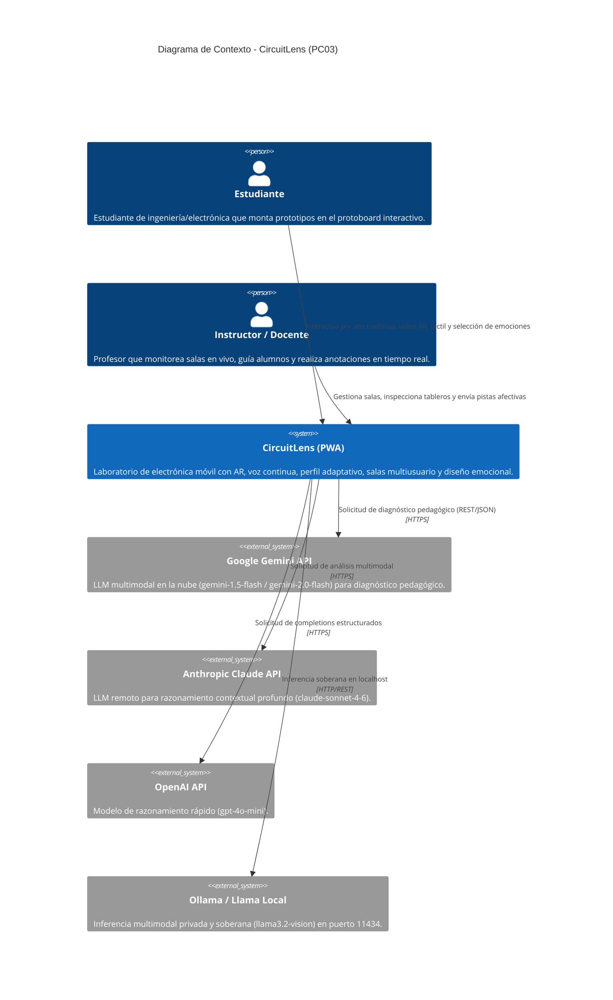
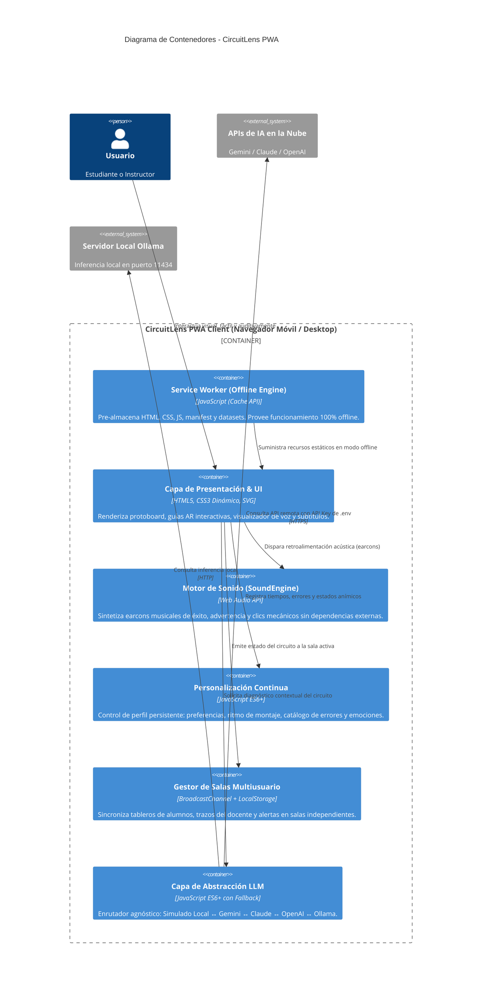
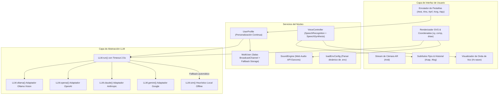

# Arquitectura del Sistema CircuitLens

Este documento describe la arquitectura de software de **CircuitLens**, un asistente inteligente y laboratorio de electrónica móvil en formato Progressive Web App (PWA) con soporte de Realidad Aumentada (AR), interacción multimodal no convencional (voz, subtítulos y earcons), personalización continua, salas multiusuario en tiempo real, capa LLM agnóstica con resiliencia, y diseño emocional basado en los tres niveles de Don Norman.

---

## 1. Diagramas C4

### Nivel 1: Diagrama de Contexto del Sistema (System Context)

El siguiente diagrama ilustra cómo los estudiantes e instructores interactúan con CircuitLens y con la diversidad de proveedores de Inteligencia Artificial locales y remotos.

---

### Nivel 2: Diagrama de Contenedores (Container Diagram)

CircuitLens opera como una Progressive Web App (PWA) cliente-céntrica que combina almacenamiento offline garantizado mediante Service Workers con sincronización bidireccional entre salas:

---

### Nivel 3: Diagrama de Componentes (Component Diagram)

Estructura modular interna del archivo `src/script.js`:

---

## 2. Marco de Diseño Emocional de Don Norman

CircuitLens implementa formalmente los tres niveles del procesamiento cognitivo y afectivo descritos por Don Norman en *Emotional Design*:

| Nivel de Norman | Dimensión de Diseño | Implementación en CircuitLens |
|---|---|---|
| **Nivel Visceral** | Estética inmediata, atracción sensorial, apariencia. | - Protoboard SVG de alta definición con pines de cobre y relieve vectorial. - **Encendido de LED realista:** resplandor dinámico (`filter: drop-shadow`) y animación de luz pulsante cuando el circuito cierra con éxito. - **Visualizador de onda de voz:** barras animadas que reaccionan cuando el asistente habla o escucha. - Micro-interacciones de confeti multicromático al dominar un circuito. |
| **Nivel Conductual** | Usabilidad, efectividad operativa, placer de uso. | - **Pines interactivos clickeables:** el alumno puede tocar directamente los círculos verdes en el protoboard para insertar componentes. - **Earcons sonoros (Web Audio API):** acorde ascendente Do-Mi-Sol para éxito, tono suave no punitivo para polaridad invertida y clic mecánico de inserción. - Retroalimentación háptica (vibración modulada en móviles). - Modo manos libres con palabra clave continua («*CircuitLens, revisa mi circuito*»). |
| **Nivel Reflexivo** | Significado personal, autoestima, metacognición. | - **Tono adaptativo del asistente:** empático (alentador ante frustración), socrático (preguntas guía) o técnico (rigor de ingeniería). - **Tarjeta de Reflexión Metacognitiva:** al terminar un circuito, explica la física detrás del montaje (Ley de Ohm, caída de tensión del diodo, divisor resistivo). - Registro persistente de emociones declaradas e inferidas para promover la mentalidad de crecimiento. |

---

## 3. Matriz de Decisiones Arquitecturales (ADR)

1. **ADR-01: Capa de Abstracción LLM con Fallback Local Resiliente**
   - *Decisión:* Encapsular proveedores en un enrutador único con timeout estricto de 2.5 s.
   - *Razón:* Un laboratorio práctico de universidad no puede depender de la estabilidad de la conexión Wi-Fi ni de cuotas de APIs externas. Si el proveedor falla, el motor heurístico local simulado responde en < 350 ms.

2. **ADR-02: Configuración Híbrida de Variables de Entorno (`.env`)**
   - *Decisión:* Permitir lectura automática de `.env` vía HTTP fetch al iniciar la PWA y permitir sobrescritura en memoria en la interfaz de Ajustes.
   - *Razón:* Facilita que el docente o evaluador coloque sus claves en un archivo `.env` estándar sin necesidad de compiladores o empaquetadores como Webpack/Vite.

3. **ADR-03: Multiusuario basado en Canales de Sala (`BroadcastChannel`)**
   - *Decisión:* Segmentar la comunicación en salas nombradas (`circuitlens_ROOMID`) complementadas con eventos `storage` de HTML5.
   - *Razón:* Permite demostraciones en vivo inmediatas abriendo dos pestañas en el mismo ordenador o sincronizando entre dispositivos sin desplegar servidores WebSockets complejos.

4. **ADR-04: Motor de Audio Cero Dependencias con Web Audio API**
   - *Decisión:* Sintetizar las ondas senoidales y cuadradas directamente en el navegador mediante osciladores y nodos de ganancia.
   - *Razón:* Garantiza que los efectos sonoros funcionen 100% offline sin descargar archivos `.mp3` o `.wav` que podrían fallar por latencia o CORS.
