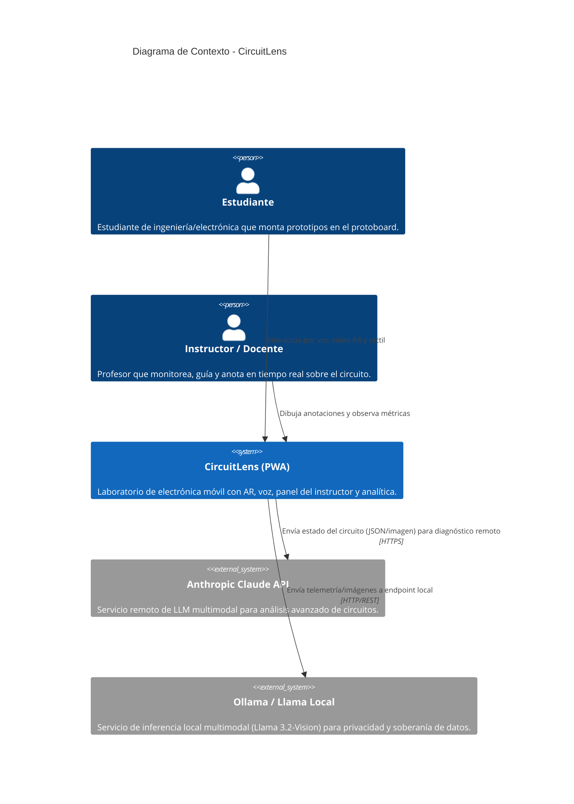
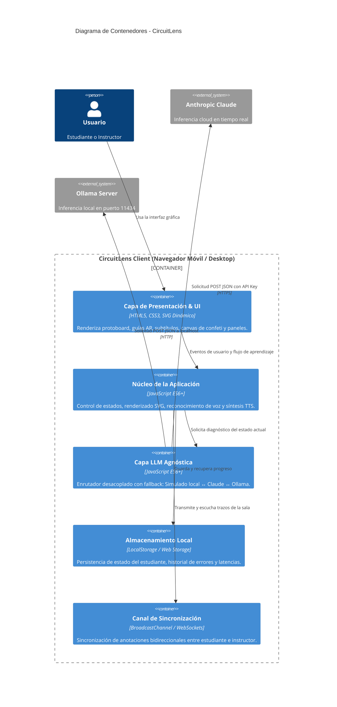
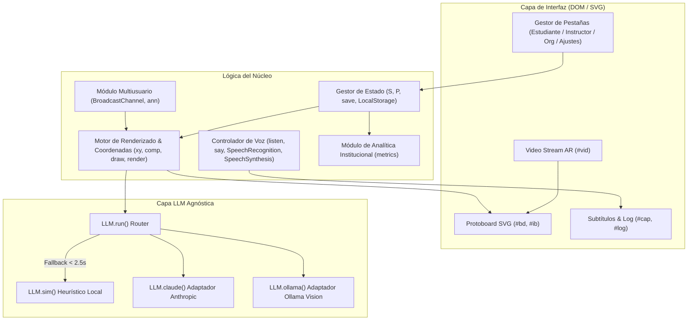

# Arquitectura de CircuitLens

Este documento describe la arquitectura de software de **CircuitLens**, un asistente inteligente y laboratorio de electrónica móvil en formato Progressive Web App (PWA) con soporte de Realidad Aumentada (AR), interacción multimodal (voz y subtítulos) y diagnóstico pedagógico automatizado.

---

## 1. Diagramas C4

### Nivel 1: Diagrama de Contexto del Sistema (System Context)

El siguiente diagrama ilustra cómo los estudiantes e instructores interactúan con CircuitLens y con los servicios externos de Inteligencia Artificial.

---

### Nivel 2: Diagrama de Contenedores (Container Diagram)

CircuitLens opera como una aplicación web progresiva (PWA) cliente-céntrica que puede ejecutarse completamente desconectada (offline) o complementarse con APIs externas.

---

### Nivel 3: Diagrama de Componentes (Component Diagram)

Detalle de los módulos internos en `script.js` y su interacción con los elementos del DOM:

---

## 2. Componentes Principales

1. **Motor de Renderizado SVG (`draw`, `comp`, `xy`)**:
   - Mapea coordenadas lógicas de protoboard estándar (rieles `p1-p20`, `m1-m20` y pistas `1a-20j`) a píxeles exactos.
   - Genera dinámicamente guías animadas de Realidad Aumentada (clase `.ring`), cables, diodos LED con indicación de polaridad y resistencias con su código de colores de 4 bandas.

2. **Capa LLM Agnóstica (`LLM`)**:
   - Patrón **Adapter / Strategy** que abstrae el proveedor de inteligencia artificial.
   - Si se selecciona un proveedor remoto y este no responde dentro de la ventana de tolerancia (2.5 s) o no cuenta con conexión, se degrada elegantemente al motor heurístico simulado (`LLM.sim`), garantizando cero interrupciones en la clase.

3. **Módulo de Asistencia Multimodal e Inclusiva**:
   - **Voz y Escucha**: Soporta comandos de voz en español mediante la Web Speech API (`SpeechRecognition`) y respuesta hablada sintética (`SpeechSynthesis`).
   - **Subtitulado Accesible**: Subtítulos de alta visibilidad para personas con discapacidad auditiva o entornos ruidosos de laboratorio.
   - **Accesibilidad Universal**: Daltonismo (rotulado textual en resistencias), alto contraste (paleta para baja visión) y baja estimulación (eliminación de animaciones para usuarios con hipersensibilidad o TDAH).

4. **Canal Multiusuario en Tiempo Real**:
   - Emplea `BroadcastChannel` local para intercomunicar pestañas simulando una red WebSockets de aula.
   - Permite al instructor ver el circuito del alumno y dibujar anotaciones visuales que desaparecen tras un lapso pedagógico de 10 segundos.

---

## 3. Decisiones de Arquitectura (ADR)

| Decisión | Justificación | Consecuencia |
|---|---|---|
| **PWA sin dependencias pesadas (Vanilla JS + CSS)** | Cero tiempos de compilación; carga instantánea en teléfonos de gama baja en laboratorios con conectividad limitada. | Máximo rendimiento y portabilidad directa vía `file:///` o servidor estático simple. |
| **Capa LLM Agnóstica con Timeout y Fallback** | Un corte de internet o una caída de API de terceros no debe detener la práctica formativa del alumno. | Alta disponibilidad garantizada en aula (SLA 100% mediante fallback local). |
| **Renderizado de Protoboard en SVG vectorial** | Escalabilidad nítida en pantallas Retina/Móvil y superposición transparente sobre la señal de cámara (`<video>`). | Facilidad para superponer efectos AR y animaciones CSS sin sobrecargar la GPU. |
| **Métricas Anonimizadas desde el Diseño** | Cumplimiento estricto de privacidad escolar y normativas de datos (FERPA/GDPR/Regulaciones locales). | No se almacenan identificadores personales; solo índices de éxito y latencia de respuesta. |
